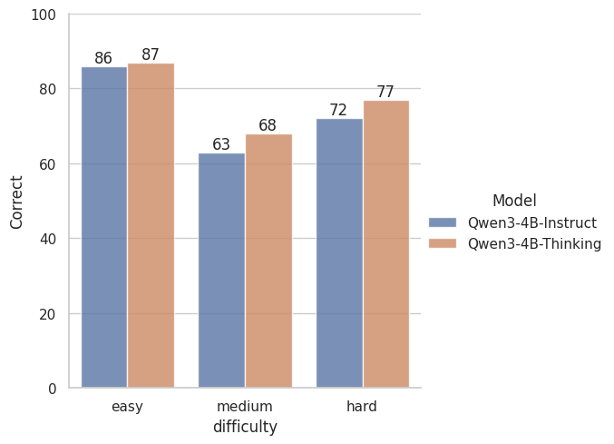
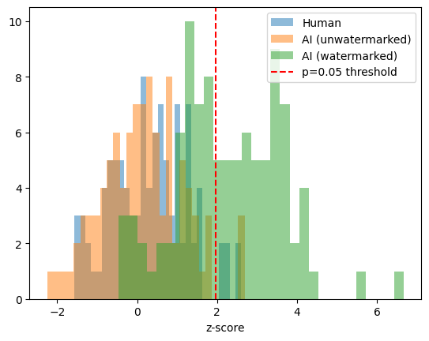
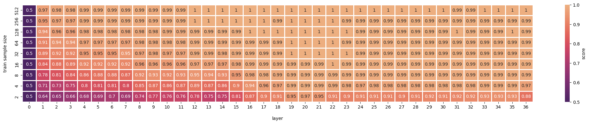
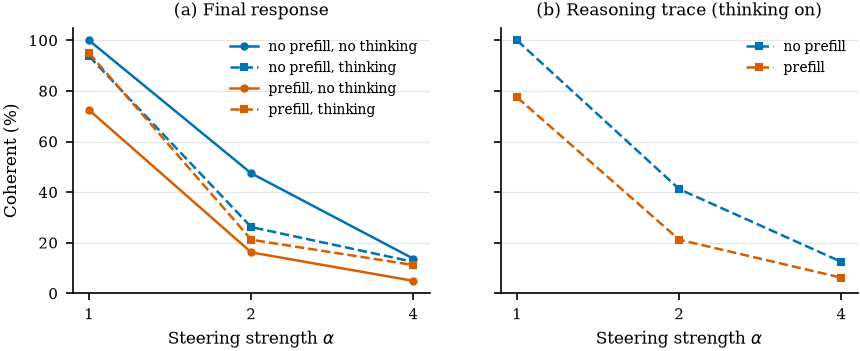
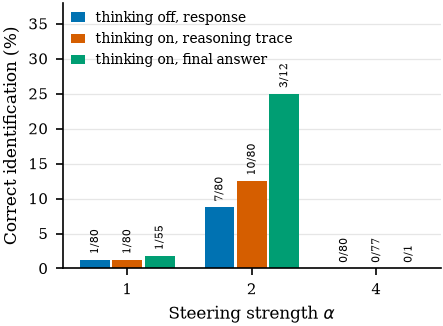

# AI Safety Mini Projects
This repo hosts the mini projects part of the [AI Safety Course at University Tübingen](https://github.com/aisa-group/tue-ai-safety-course)

## Projects
The projects are hands-on experiments in LLM safety: comparing base and post-trained models, jailbreaking, emergent misalignment, and detecting LLM-generated text.
Later projects look inside the model, using probing and activation steering on the residual stream. The final project uses this to test whether a model is aware of steering vectors injected into it.

1. [Base vs. post-trained LLMs and LLM jailbreaking](/01)
2. [Emergent misalignment and detection of LLM-generated text](/02)
3. [Understanding Data and Model Steering](/03)
4. [Final project: Steering awareness with concept and contrastive vectors](/04_final)

## Highlights

### 01 · Instruct vs. thinking model on MentalBench
Number of correct single-choice answers (100 samples per difficulty) for Qwen3-4B-Instruct and Qwen3-4B-Thinking.

### 02 · Detecting watermarked LLM text
Detection z-scores for human, unwatermarked AI and watermarked AI text. Watermarked text is clearly shifted to higher z-scores, and a large share of it crosses the p = 0.05 threshold. Human and unwatermarked text mostly stay below it.

### 03 · Probing Qwen3-4B for harmfulness
Linear-probe accuracy per layer and training-set size on the [AdvBench–Alpaca contrastive dataset](https://huggingface.co/datasets/traberph/advbench-alpaca-contrastive). Harmfulness is almost linearly separable from layer 1 onwards, given enough samples. With only 2 training samples, the probes reach their highest accuracy around layers 18–21.

### 04 · Steering awareness in Gemma 4 31B
Coherence of the model's output drops quickly as the steering strength α increases (left). The model correctly identifies the injected concept only rarely, peaking at α = 2 (right).

 
